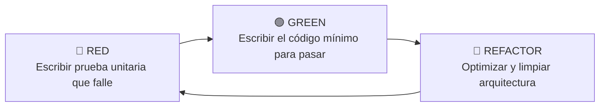

# Coffee Machine Simulator &bull; Test-Driven Development (TDD)

[](https://github.com/MrAldox/TDD/actions/workflows/ci-pipeline.yml)
[](https://www.python.org/)
[](https://pytest.org/)
[](LICENSE)

Implementación práctica de la metodología **Test-Driven Development (TDD)** en Python para un simulador de máquina expendedora de café con control de inventarios, validaciones de insumos y testing automatizado continuo con **GitHub Actions (CI/CD)**.

---

## 📌 Tabla de Contenidos

- [Metodología TDD](#-metodología-tdd)
- [Arquitectura y Estructura](#-arquitectura-y-estructura)
- [Reglas de Negocio](#-reglas-de-negocio)
- [Instalación y Configuración](#-instalación-y-configuración)
- [Ejecución de Pruebas](#-ejecución-de-pruebas)
- [Integración Continua (CI/CD)](#-integración-continua-cicd)
- [Licencia](#-licencia)

---

## 🔁 Metodología TDD

El proyecto fue desarrollado siguiendo estrictamente el ciclo iterativo **Red-Green-Refactor**:



1. **🔴 Red:** Definición previa de casos de prueba para cada requerimiento funcional (vasos agotados, insumos insuficientes, validación de tamaños).
2. **🟢 Green:** Implementación de la lógica en `CoffeeMachine` para satisfacer todas las aserciones.
3. **🔵 Refactor:** Modularización en paquetes limpios (`src/` y `tests/`), anotaciones de tipo (*Type Hinting*) y fixtures con Pytest.

---

## 📁 Arquitectura y Estructura

El repositorio sigue las mejores prácticas de estructuración de paquetes en Python:

```text
TDD/
├── .github/
│   └── workflows/
│       └── ci-pipeline.yml      # Pipeline CI automatizado para múltiples versiones de Python
├── src/
│   ├── __init__.py
│   └── coffee_machine.py        # Clase CoffeeMachine y lógica de dominio
├── tests/
│   ├── __init__.py
│   └── test_coffee_machine.py   # Suite completa de pruebas unitarias (Pytest)
├── .gitignore
├── LICENSE
├── pytest.ini                   # Configuración del runner de pruebas
├── README.md
└── requirements.txt             # Dependencias del proyecto
```

---

## ☕ Reglas de Negocio

La máquina gestiona 3 insumos finitos: **Vasos**, **Café (onzas)** y **Azúcar (cucharadas)**.

| Tamaño | Onzas de Café requeridas |
| :--- | :---: |
| **Pequeño** | `3 Oz` |
| **Mediano** | `5 Oz` |
| **Grande** | `7 Oz` |

### Validaciones implementadas:
* Disponibilidad de vasos antes de preparar.
* Validación estricta de tamaño permitido (`Pequeño`, `Mediano`, `Grande`).
* Existencia suficiente de onzas de café requeridas.
* Disponibilidad de cucharadas de azúcar solicitadas.
* Descuento automático de inventario tras cada despacho exitoso.

---

## 🚀 Instalación y Configuración

### 1. Clonar el repositorio
```bash
git clone https://github.com/MrAldox/TDD.git
cd TDD
```

### 2. Crear y activar entorno virtual
```bash
# Windows
python -m venv venv
.\venv\Scripts\activate

# Linux / macOS
python3 -m venv venv
source venv/bin/activate
```

### 3. Instalar dependencias
```bash
pip install -r requirements.txt
```

---

## 🧪 Ejecución de Pruebas

Para ejecutar la suite de pruebas unitarias con reporte de cobertura detallado:

```bash
pytest --cov=src --cov-report=term-missing
```

Salida esperada:
```text
============================= test session starts =============================
collected 9 items

tests/test_coffee_machine.py::TestCoffeeMachineSuccessCases::test_seleccion_tamano_pequeno PASSED [ 11%]
tests/test_coffee_machine.py::TestCoffeeMachineSuccessCases::test_seleccion_tamano_mediano PASSED [ 22%]
tests/test_coffee_machine.py::TestCoffeeMachineSuccessCases::test_seleccion_tamano_grande PASSED  [ 33%]
tests/test_coffee_machine.py::TestCoffeeMachineSuccessCases::test_servicio_con_azucar PASSED      [ 44%]
tests/test_coffee_machine.py::TestCoffeeMachineSuccessCases::test_actualizacion_inventario PASSED [ 55%]
tests/test_coffee_machine.py::TestCoffeeMachineValidationAndErrors::test_error_sin_vasos PASSED   [ 66%]
tests/test_coffee_machine.py::TestCoffeeMachineValidationAndErrors::test_error_tamano_invalido PASSED [ 77%]
tests/test_coffee_machine.py::TestCoffeeMachineValidationAndErrors::test_error_sin_cafe_suficiente PASSED [ 88%]
tests/test_coffee_machine.py::TestCoffeeMachineValidationAndErrors::test_error_sin_azucar_suficiente PASSED [100%]

---------- coverage: platform win32, python 3.13 -----------
Name                     Stmts   Miss  Cover   Missing
------------------------------------------------------
src\__init__.py              2      0   100%
src\coffee_machine.py       20      0   100%
------------------------------------------------------
TOTAL                       22      0   100%
```

---

## ⚙️ Integración Continua (CI/CD)

Este proyecto incluye una matriz de pruebas automatizada con **GitHub Actions** en cada `push` o `pull request` evaluando compatibilidad en:
* Python 3.10
* Python 3.11
* Python 3.12
* Python 3.13

---

## 📄 Licencia

Este proyecto se encuentra bajo la Licencia [MIT](LICENSE).
Desarrollado por [Eduardo Martinez](https://github.com/MrAldox).
